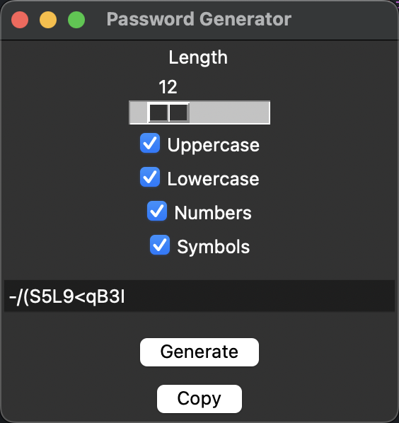
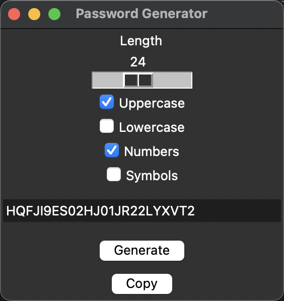
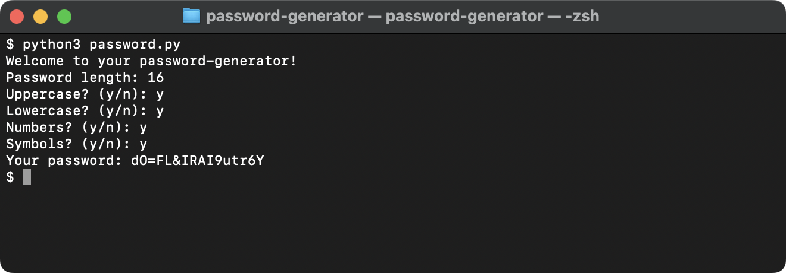

# Password Generator

A small project I made for private use, so I can create safe passwords for my stuff.

<p>
  
  
</p>

## Features

- Choose the password length
- Pick which characters to use: uppercase, lowercase, numbers, symbols
- Uses Python's `secrets` module, so the passwords are actually random and not guessable
- Works in the terminal or with a small UI
- Copy button to put the password straight into your clipboard

## How to use

### UI

```
python3 ui.py
```

Set the length with the slider, tick the boxes you want and click **Generate**. **Copy** puts the password in your clipboard.

### Terminal

```
python3 password.py
```



If you type something that isn't a number (or less than 4), it just uses 12.

## Project structure

```
password-generator/
├── password.py   # password logic + terminal version
├── ui.py         # the UI (tkinter)
└── images/       # screenshots for this README
```

## Requirements

- Python 3
- tkinter for the UI. It usually comes with Python. If you installed Python with Homebrew on a Mac, you have to install it separately:
  ```
  brew install python-tk
  ```
